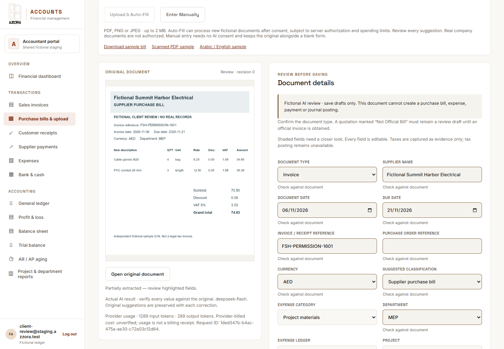
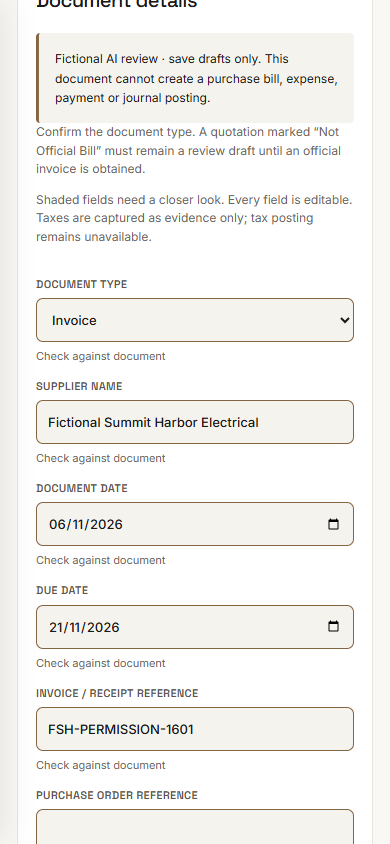
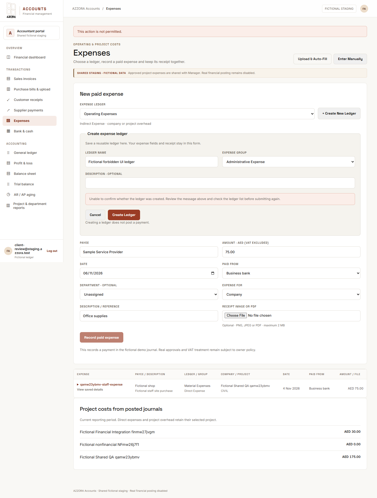
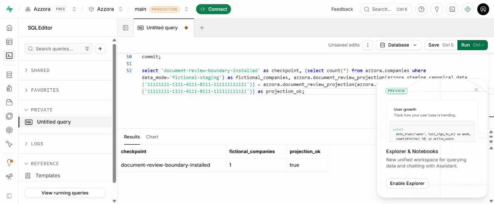

# Client document-review permission fix and Preview release

6 November 2026. **GO for owner acceptance of the new immutable fictional-data Preview. Stable-link replacement still requires owner approval. Production accounting remains NO-GO.**

## Exact candidate and preserved releases

- Preview: https://azzora-accounts-client-review-8x0m4wael-faziils-projects.vercel.app/accountant.html
- Deployment: `dpl_HbzNp2oVMMA3Lv83kHZLxU7atPrQ`, READY Preview (Vercel target null).
- Application: `bcf80caa4d8eef9308b18da64462be9cc0dbf9f8` on `codex/azzora-client-document-permissions`.
- This is a source-upload deployment without Vercel Git metadata. All 252 uploaded application/API/script/package files checked against the frozen local source match their Vercel SHA1 file UIDs; no mismatches. No credentials, local temporary files, dependencies or generated build directories were included in the uploaded source.
- Stable Accounts remains `dpl_ESphaGfTKeRK8wzRt7AcYiaWwSjy`. Manager remains `dpl_F9kD9Vu4ioWTCJrQwD2ev5J6mYmp`. GitHub main remains `fd7754dfe0022f9b64bf875313bd9679cb0144eb`.
- No stable alias reassignment, production promotion, GitHub push, main merge or production environment change occurred.

## Narrow correction

The rejected implementation treated ledger/account creation as nonfinancial and therefore allowed finance.draft. The shared command boundary now reserves that capability for document-draft only; every other Accounts action requires finance.simulate and the existing privileged role/workspace checks. Upload/extraction retains its existing authenticated document path. No AI, accounting calculation, module or UI source was changed.

An additive staging migration checks canonical state before any draft-only database commit. Even a forged financial:false request may change only document review/attachment records and remembered document supplier defaults. Customers, suppliers, projects, financial records, chart of accounts, periods, journals, snapshots and all other workspace metadata must remain unchanged. Existing company locks, atomic commits, idempotency and immutable-history guards are retained. New helper execution is revoked from browser roles; existing private-schema grants and RLS remain in place.

Migration: `20261106075301_document_review_write_boundary.sql`, SHA256 `2650fc15d9cc1a64b217b5398ef951a20cdbc28997a395042a4875a50787b2f0`. Installed and observed in the existing authorized fictional Supabase project; no users, memberships or business records were migrated by that SQL. It was applied through SQL Editor, consistent with prior staging migrations; this report does not claim CLI migration-history reconciliation or db push.

## Final test evidence

| Gate | Final result |
| --- | --- |
| Unit regression | **1,107 passed**, 82 files, 0 failed; includes 57 new domain/API/SQL regressions |
| TypeScript / full source ESLint | Passed, no new lint debt |
| Financial fixture and native ESM startup | **3 passed**,0 failed |
| Default and AI-Preview production builds | Both passed; existing bundle-size/third-party annotation warnings remain |
| Combined CRM browser regression on frozen application | **9/9 suites passed**: core CRM, commercial, operations, workforce, recovery, quotations/PDFs, Accounts, timeline independent, timeline date positioning |
| Actual hosted restricted-client journey | **12 groups passed**,30 route/viewport checks at 1440/390px; zero browser errors |
| Direct hosted restricted financial/master-data actions | **14/14 HTTP403**: invoice/bill creation and amendment/issuance, receipts/payments, expenses, transfers, review conversion, ledger and cash-account creation |
| Direct Manager/admin commands | **6/6 HTTP403**: approval, staff/admin changes, Manager payment/refund/credit paths |
| Bank/cash type variants | Bank, cash and staff-cash creation each returned **HTTP403** at MFA2; snapshot/version unchanged |
| Actual UI submissions | Ledger and cash-account submissions both HTTP403; typed form values retained; no records created |
| Live canonical RPC forgery | **4/4 HTTP403/PT403** for account, ledger, invoice and metadata changes falsely marked nonfinancial; full canonical data and company version unchanged |
| Browser Supabase access at MFA2 | **3 privileged RPCs HTTP403/42501**; 4 private table routes unavailable with 406/PGRST106 because azzora is not an exposed browser schema |
| Legitimate Owner and Accountant hosted regression | Each created one fictional expense ledger and one zero-balance cash account: **4/4 HTTP200**; existing transactions/balances unchanged,0 new journals |
| Sessions/private originals | Actual password/MFA2, refresh, private attachment hash, unauthorized/unknown file handling and logout passed |

The initial ad hoc regression harness hit a 240-second operational timeout and listed a nonexistent planning-browser filename. The canonical nine-suite set was then completed on the frozen revision, with the actual timeline suites and a sufficient run duration. Final operational coverage is 136 checks at 1440/1024/768/390px. Core CRM 66, commercial 129, workforce 40 and recovery 25 reported checks also pass. Additional boundary/corrective/BOQ checks passed; they are not substituted for the final nine-suite evidence.

## AI and financial invariants

One new, previously unseen fictional image G16 was uploaded through the actual hosted form after consent. DeepSeek returned a fresh result, request `1ded347b-b4ac-475a-ae30-c72a03c12d64`, 1289 input and 289 output tokens. Supplier/date/reference, item descriptions, quantities, rates, document totals and supplier-bill classification matched the fixture. Uncertainty highlights remain; the UI calls this a partial extraction requiring review. Fields were edited/restored and reviewed before Save Draft. Screenshots are of the review form after reviewer selections, not an assertion that every displayed value was untouched model output.

The original remains private and hash-identical. Save Draft retained raw extraction and one correction, without changing any financial record, journal, balance or catalog. The twenty pre-existing journal entries reconcile; trial debits and credits are each 10209000fils and balance-sheet difference is 0. Revenue 200000fils, cost of sales 20500, gross/net 179500, AR 168000, AP 9000, bank 10020500 and cash 0 remain unchanged. Two new ledgers and two zero-balance cash accounts were deliberately retained as fictional Owner/Accountant permission-test fixtures (PERMISSION-OWNER-* and PERMISSION-ACCOUNTANT-*); no restricted-account master record was created.

Shared USD5 application ledger now has **24 metered records**, preserving the 23-record prior history. The new call's peak-tariff upper estimate is **USD0.000734**, cumulative exposure **USD0.015816**, remaining **USD4.984184**. Actual provider token usage is confirmed; provider-billed dollar charges and provider-account spending controls remain unverified under the owner's existing application-cap exception. No reset, new allowance or additional benchmark was introduced.

## Access, limitations and next approval

- Separate Accountant login and individual MFA2 were verified on the immutable hostname. The temporary QA authenticator was retired and its seed scrubbed from the local client identity file; no other user's MFA was changed. Yusuf must enroll his own authenticator at the approved handoff.
- No credentials were shared and no invitation was sent. The existing private local access packet remains marked HOLD pending owner release approval.
- The accepted UI is preserved. Existing financial-action forms may remain visible, but restricted submissions are denied server-side; no button hiding is relied on for authorization.
- Real-company documents, real posting, production accounting and unresolved VAT/business policies remain blocked. Use fictional files only.
- The old stable deployment is retained. Approval of this exact new deployment is required before replacing its alias; the post-switch stable-host acceptance and rollback gate must still run afterward.

## Screenshots and reproducible evidence

[All evidence](evidence/client-document-permissions-2026-11-06/combined-browser-results.json), [hosted results](evidence/client-document-permissions-2026-11-06/results.json), [live SQL guard](evidence/client-document-permissions-2026-11-06/live-sql-guard.json), [metering](evidence/client-document-permissions-2026-11-06/metering-proof.json), [uploaded source verification](evidence/client-document-permissions-2026-11-06/deployment-source-verification.json).

