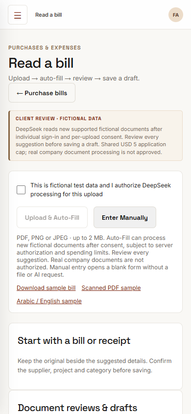
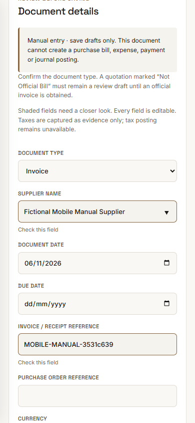

# Mobile document entry — fixed and live

6 November2026. The existing stable Accounts link now uses deployment dpl_8z1ZPMgRgJDkzpzfYeDazjKZwdFo, tested application eeca2c6edaeabcc3db6495d77dd2fa534a609095 on codex/azzora-mobile-document-entry. Source stages:0c354aa (behavior and persistence),eeca2c6 (manual provenance label). Previous password-only deployment dpl_Fc8JzKLaxZDiibArhuxSWeX6xUEp is retained for rollback.

URL: https://azzora-accounts-client-review-faziils-projects.vercel.app/accountant.html

## Root causes and correction

The Accounts file inputs had capture=environment, which can force a phone camera intent. Enter Manually was also a file-input label, so it opened that same camera/file workflow. Capture is removed from document Auto-Fill and the optional purchase-bill/expense attachment fields. Upload retains PDF/PNG/JPEG acceptance and the existing2MB limit; the browser/OS can offer normal file/photo choices.

Enter Manually is now an ordinary button. It opens a local blank review immediately, without requesting a file, requiring AI consent, contacting an extractor or creating an empty saved record. The typed details are saved atomically through the existing reviewed-draft validation and shared command boundary. No fabricated attachment or AI result is created. The manual record has explicit manual provenance and draft-only policy. Corrections and reopening after refresh use the existing document-review history.

The additional document-manual action is explicitly classified as document draft access. It cannot create a ledger/account, invoice, payment, expense or journal. No new financial engine, database migration, paid provider or auth policy was introduced. Password-only restricted client access and full-role MFA remain intact.

## Exact checks

-1,128 unit tests across84 files passed on the frozen final source;3 native/financial fixture checks passed. TypeScript, ESLint and default/Preview builds passed. An initial unrestricted parallel unit run hit a5-second import timeout; the full suite passed with two workers without changing test assertions/timeouts.
-10 mocked Auto-Fill/manual UI contract groups passed, including partial/empty/complete provider states and existing editable field behavior.
- Immutable Preview and actual stable hostname each passed7 hosted groups, with zero browser errors. Desktop1440px and touch/mobile390px layouts were inspected.
- Actual Upload click raised the browser file-chooser event with no capture attribute and PDF/image acceptance. Cancel produced zero extraction requests. Manual clicks raised no file-chooser event and made no extraction request.
- Opening the blank manual form left the company version and saved-review count unchanged. One confirmed fictional manual draft per deployment saved once without an attachment, survived refresh and retained correction history.
- Financial metrics, ledger, trial balance, statements, invoices, bills, payments, expenses, transfers, accounts and catalog were unchanged after Save Draft. Six prohibited financial/master-data requests remained403.
- Existing login/logout/revocation passed. Manager production remains dpl_F9kD9Vu4ioWTCJrQwD2ev5J6mYmp; GitHub main remains fd7754dfe0022f9b64bf875313bd9679cb0144eb. No push/main merge or production promotion.
- No paid AI calls were made by these tests. Shared USD5 history remains27 metered records, conservative exposure USD0.017753, remaining USD4.982247. Billing dollars remain unverified; no spending history was reset.

Mobile testing used Chromium touch/mobile emulation, not a physical Android/iOS device. The native phone picker appearance is OS-controlled. The forced capture attribute is absent and the chooser event was verified. Reopen or refresh the phone's existing tab to load the corrected UI.

Real-company processing/posting and production accounting remain disabled. The two saved manual examples are fictional acceptance fixtures only.

