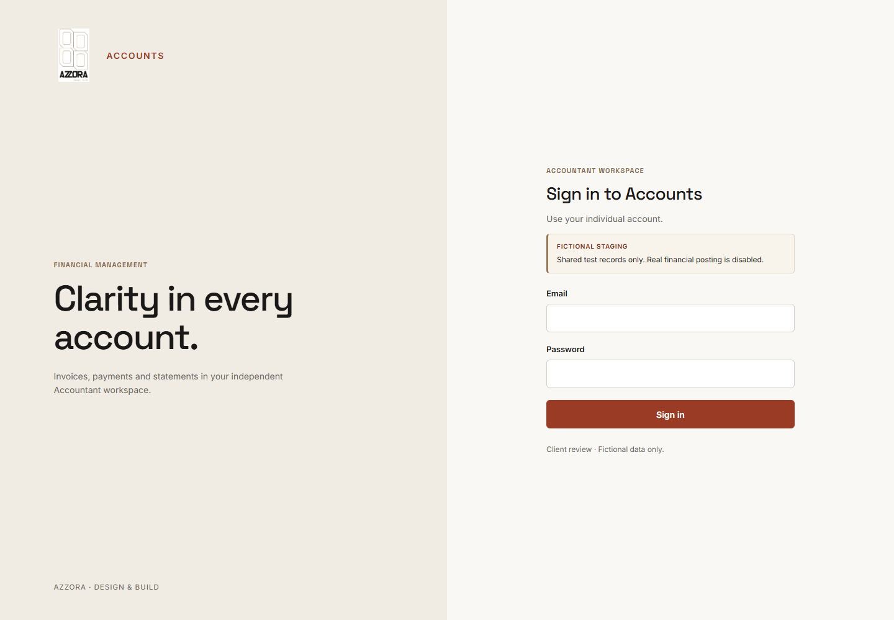
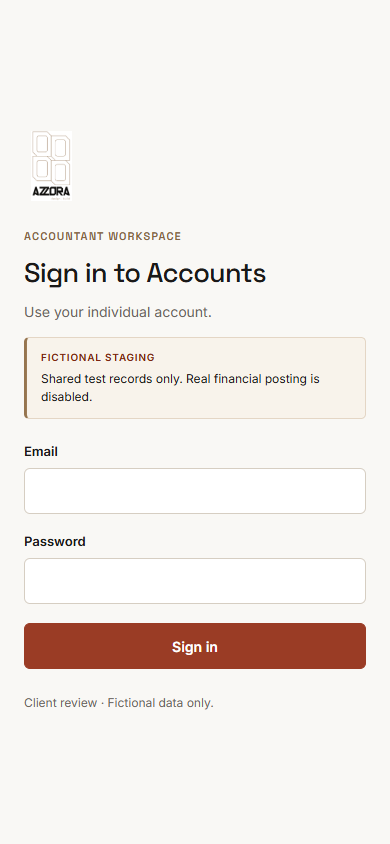

# Restricted client password-only login — live

Subsequent release: [mobile upload/manual-entry correction](MOBILE-DOCUMENT-ENTRY-FIX.md). Password-only access remains unchanged.

6 November 2026. Owner explicitly selected email/password-only login for the client-review account. Implemented and verified on the stable hostname.

- URL: https://azzora-accounts-client-review-faziils-projects.vercel.app/accountant.html
- Deployment: dpl_Fc8JzKLaxZDiibArhuxSWeX6xUEp, Preview; no production promotion.
- Application: 70037d480e99d260785c13bbf5c79ed4f41b9bb9, branch codex/azzora-login-cleanup.
- Rollback retained: dpl_HbzNp2oVMMA3Lv83kHZLxU7atPrQ.
- Manager stays dpl_F9kD9Vu4ioWTCJrQwD2ev5J6mYmp; main stays fd7754dfe0022f9b64bf875313bd9679cb0144eb. No push/main merge/Manager change.

## Scope and security

This is genuine Supabase email/password authentication with an encrypted server session, secure HttpOnly cookie, same-origin/CSRF checks and revocation. The real assurance level is aal1; it is not described as MFA2. The exemption is server-resolved for the exact fictional client UUID/company, Accountant-only workspace and exactly finance.read/finance.draft. Broader capabilities, another identity/company or missing policy cannot use the exception. Owner and full Accountant MFA requirements remain in force; their actual hosted sign-ins still return mfa-challenge and pre-MFA data access returns401.

The client reaches its dashboard directly, without authenticator enrollment, manual setup or recovery links. The email-to-code-input reuse defect is fixed for remaining MFA flows by remounting the form between credential and code steps. Existing accounts/passwords and MFA factors were not deleted or reset. Fictional-data labeling remains visible.

## Verification

-1,121 unit tests across83 files passed,0 failed;3 native/financial fixture checks passed. TypeScript, full source ESLint and default/Preview builds passed.
- Both immutable Preview and stable hostname passed13 hosted groups and30 desktop/mobile route checks each, with no browser errors.
- Actual client email/password sign-in returns authenticated at aal1; wrong password401; logout200 and subsequent session401.
-14 prohibited financial/master-data commands403;6 Manager/admin commands403; ledger and account UI submissions403. Four live canonical RPC forgeries at aal1 returned403 and preserved the full canonical data/version.
- Fresh fictional G18 (Preview) and G19 (stable) uploads ran real DeepSeek, populated editable supplier/date/reference/items/quantities/rates/totals, and saved reviewed drafts. Uncertain classification remains subject to human selection; screenshots do not imply every field was untouched AI output. Original extraction/private originals/history are preserved. Financial balances and the20 journals were unchanged.
- Shared USD5 application ledger history was preserved:27 metered records, conservative cumulative exposure USD0.017753, remaining USD4.982247. These two calls each had an upper estimate USD0.000646, based on actual1289 input/216 output tokens. Provider-billed charges and provider-account controls remain unverified under the existing application-cap exception. No budget reset.

Real-company processing/posting and production accounting remain disabled. This change authorizes password-only access to restricted fictional review, not additional finance permissions or production release.

The existing private access packet now contains the stable URL and email/password-only instructions. No password is included in this report, no credentials were sent to Yusuf and no invitation was issued. Refresh an old open tab before signing in.

