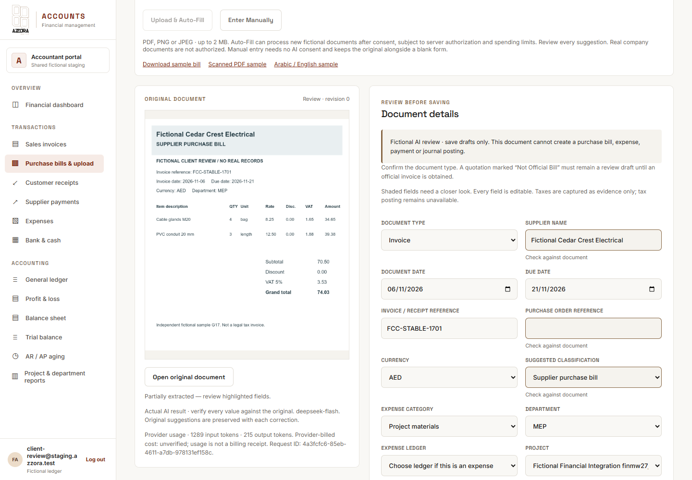
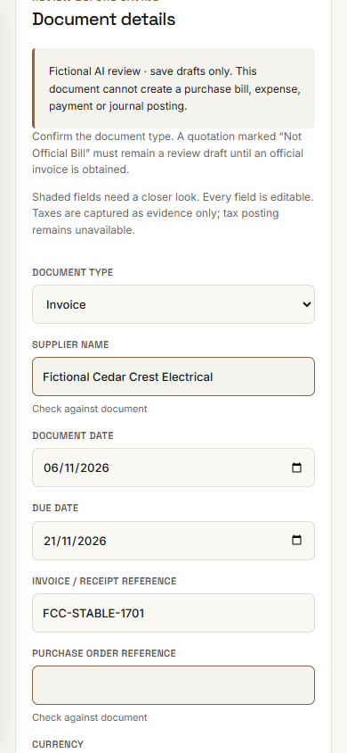

# Stable Accounts client release — verified

Superseded login requirement: owner subsequently approved [password-only restricted client login](PASSWORD-ONLY-CLIENT-LOGIN-RELEASE.md). Prior MFA release evidence below is historical.

6 November 2026. Owner-approved alias replacement completed. **GO for restricted fictional-data client review.** No build, production promotion, source modification, GitHub push or main merge occurred during this release.

- Stable URL: https://azzora-accounts-client-review-faziils-projects.vercel.app/accountant.html
- Exact assigned deployment: `dpl_HbzNp2oVMMA3Lv83kHZLxU7atPrQ`.
- Verified application: `bcf80caa4d8eef9308b18da64462be9cc0dbf9f8`; source branch `codex/azzora-client-document-permissions`.
- Previous deployment `dpl_ESphaGfTKeRK8wzRt7AcYiaWwSjy` is retained for rollback. No rollback was necessary.
- Manager production remains `dpl_F9kD9Vu4ioWTCJrQwD2ev5J6mYmp`; GitHub main remains `fd7754dfe0022f9b64bf875313bd9679cb0144eb`.

## Tests on the actual stable hostname

All twelve hosted workflow groups passed, including thirty route/viewport checks at1440 and390px with zero browser errors. Actual individual login and MFA2, refresh, private originals, financial reports, document review/correction, Save Draft and logout passed. There was no Vercel-login redirect.

Fourteen direct financial/master-data commands returned403. Six Manager/admin commands returned403. Actual UI expense-ledger and cash-account submissions returned403 and preserved typed form inputs. Bank, cash and staff-cash creation variants each returned403 with the entire snapshot and version unchanged. Four forged canonical database writes falsely marked nonfinancial returned403/PT403 and left canonical data/version unchanged.

A fresh fictional G17 bill generated one uncached DeepSeek result through the stable UI: request `4a3fcfc6-85eb-4611-a7db-978131ef158c`,1289 input and215 output tokens. Supplier/date/reference, both item descriptions, quantities, rates and totals matched. Classification was unknown and highlighted; the reviewer selected supplier purchase bill. The UI accurately retained its partial-extraction/review-required status. Screenshots are after reviewer selections, not untouched AI output.

Save Draft preserved the original extraction, one correction and the private attachment hash. No invoice, payment, catalog or journal mutation occurred. The twenty existing journals remained balanced; trial debits/credits each10209000fils and balance-sheet difference0. Financial metrics remained identical before extraction and after draft saving.

The shared USD5 ledger retains all prior history:25 metered records, cumulative conservative exposure USD0.016461 and remaining USD4.983539. This call's upper estimate is USD0.000645 from actual token usage. Provider-billed dollars and provider-account controls remain unverified under the owner's existing application-cap exception. No budget reset occurred.

## Access and handoff

The private local access packet was updated to the stable URL after all tests passed. It contains the existing individual credentials and no API key or MFA seed. No credentials were posted in chat, no message was sent to Yusuf and no invitation was issued. The owner should deliver the password privately.

Only this release's temporary QA factor was retired; other users' factors were untouched. The QA session is logged out and rejected afterward. Yusuf must enroll his own authenticator on first sign-in. Access remains finance.read/finance.draft only, Accountant workspace. Real-company processing/posting, production accounting and unresolved VAT treatment stay blocked.

The prior immutable Preview regression (1,107 units, nine combined browser suites, TypeScript, ESLint, builds and native/fixture tests) remains applicable because this operation changed only the alias. See [permission-fix report](CLIENT-DOCUMENT-PERMISSIONS-RELEASE.md) for those results and source-upload verification.

[Hosted test evidence](evidence/stable-client-release-2026-11-06/results.json), [denied UI writes](evidence/stable-client-release-2026-11-06/ui-denials.json), [bank/cash variants](evidence/stable-client-release-2026-11-06/bank-cash-type-denials.json), [metering](evidence/stable-client-release-2026-11-06/metering-proof.json).

